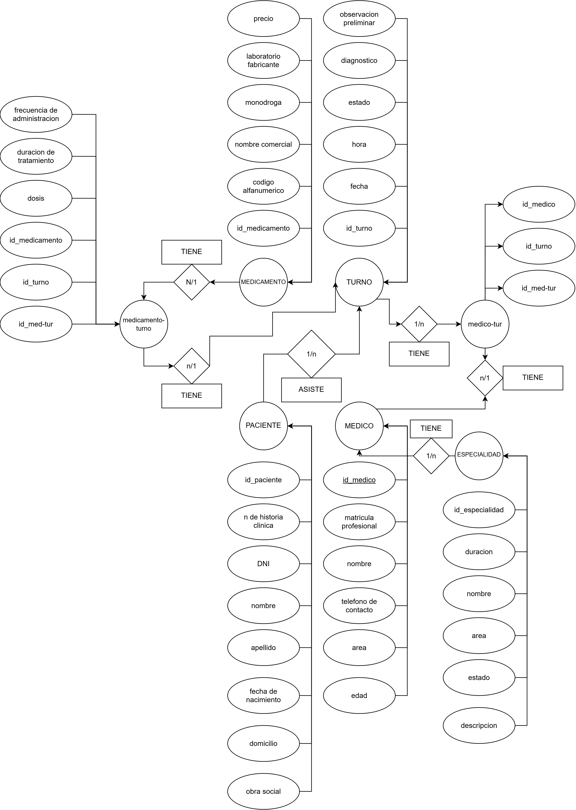

# BASE DE DATOS — Ejercicio 3: Gestión de Historia Clínica Electrónica en una Clínica Médica

Trabajo práctico de Base de Datos (Universidad Champagnat). Este repositorio contiene todo el desarrollo del ejercicio 3: modelo entidad-relación, modelo relacional y normalización (1FN, 2FN y 3FN).

## Consigna


#### Contexto


El directorio de una clínica privada busca centralizar la información médica de sus pacientes mediante una historia clínica electrónica unificada que evite la pérdida de diagnósticos y optimice la asignación de turnos profesionales.


#### Consigna


Diseñar el esquema conceptual de base de datos para la clínica considerando las siguientes reglas de negocio:

De los pacientes se almacena su número de historia clínica (PK), DNI, nombre y apellido, fecha de nacimiento, domicilio y obra social a la que pertenece.

Los médicos de la institución se identifican por su matrícula profesional, registrando además su nombre, teléfono de contacto y la especialidad principal que ejercen (un médico puede tener una especialidad principal, pero también se requiere registrar otras especialidades secundarias que posea).

Un paciente puede solicitar y atenderse en múltiples turnos médicos con diferentes profesionales. Cada turno registra fecha, hora, estado (Programado, Atendido, Cancelado) y un diagnóstico u observación preliminar.

En el marco de una consulta médica, el profesional puede recetar medicamentos al paciente. Un medicamento se identifica por su código alfanumérico, nombre comercial, monodroga y laboratorio fabricante.

En una misma consulta se pueden recetar varios medicamentos, indicando obligatoriamente la dosis, la frecuencia de administración y la duración del tratamiento. Asimismo, un medicamento puede ser recetado en diferentes consultas y pacientes a lo largo del tiempo.


#### Desarrollo requerido


Identificar las entidades del dominio sanitario y sus atributos atómicos correspondientes.

Definir la relación entre Paciente y Médico a través de la entidad Turno, especificando sus atributos propios.

Modelar la relación entre Médico y Especialidad, analizando si se trata de una relación N:M (dado que un médico puede tener varias especialidades y una especialidad puede pertenecer a varios médicos).

Diseñar la relación N:M entre Consulta/Turno y Medicamento, incorporando los atributos de prescripción (dosis, frecuencia y duración).

## Estructura del repositorio

```
BASE_DE_DATOS_Ejercicio_3/
├── README.md
├── modelo-er/
│   ├── ejercicio_3.drawio        # diagrama editable (draw.io)
│   └── ejercicio_3.png           # exportación del diagrama
├── modelo-relacional/
│   ├── ejercicio_3_MR.xlsx               # modelo relacional
│   └── ejercicio_3_con_datos.xlsx        # modelo relacional con datos de ejemplo
└── normalizacion/
    ├── ejercicio_3_1FN.xlsx
    ├── ejercicio_3_2FN.xlsx
    └── ejercicio_3_3FN.xlsx
```

## Modelo entidad-relación



Archivo editable: [`modelo-er/ejercicio_3.drawio`](modelo-er/ejercicio_3.drawio).

## Modelo relacional

Tablas del modelo relacional original, antes de normalizar (`(PK)` clave primaria, `(FK)` clave foránea, `(UNIQUE)` valor único):

- **MEDICAMENTO**: `Id_medicamento(PK)`, `codigo alfanumerico(UNIQUE)`, `nombre comercial`, `monodroga`, `laboratorio fabricante`, `precio`
- **MEDICO**: `Id_medico(PK)`, `matricula profesional(UNIQUE)`, `nombre`, `telefono de contacto(UNIQUE)`, `area`, `edad`
- **ESPECIALIDAD**: `Id_especialidad(PK)`, `duracion`, `nombre`, `area`, `estado`, `descripcion`, `Id_medico(FK)`
- **MEDICO-TUR**: `Id_med-tur(PK)`, `Id_turno(FK, PK)`, `Id_medico(FK,PK)`
- **MEDICAMENTO-TURNO**: `Id_medicamento-turno(PK)`, `Id_turno(FK, PK)`, `Id_medicamento(FK, PK)`, `dosis`, `duracion del tratamiento`, `frecuencia de administracion`

Archivos: [`ejercicio_3_MR.xlsx`](modelo-relacional/ejercicio_3_MR.xlsx) y [`ejercicio_3_con_datos.xlsx`](modelo-relacional/ejercicio_3_con_datos.xlsx).

## Lógica relacional

Cada entidad se convierte en una tabla con su clave primaria. Las relaciones se representan así:

- **1:N / N:1**: la clave primaria del lado "uno" se copia como clave foránea (FK) en la tabla del lado "muchos".
- **1:1**: igual que 1:N, pero la FK lleva restricción UNIQUE.
- **N:M**: se crea una tabla intermedia cuyas FK forman una clave compuesta, junto con una clave propia que se identifica por esa combinación.

Relaciones del modelo final (3FN):

- `TURNO` → `PACIENTE`: **N:1** (FK `id_paciente` en `TURNO`).
- `PACIENTE` → `CIUDAD`: **N:1** (FK `id_ciudad` en `PACIENTE`).
- `ESPECIALIDAD` → `MEDICO`: **N:1** (FK `id_medico` en `ESPECIALIDAD`).
- `TURNO` ↔ `MEDICO`: relación **N:M**, resuelta con la tabla intermedia `MEDICO-TUR` (sus FK forman la clave compuesta única).
- `TURNO` ↔ `MEDICAMENTO`: relación **N:M**, resuelta con la tabla intermedia `MEDICAMENTO-TURNO` (sus FK forman la clave compuesta única).

## Normalización

Los cambios se muestran etapa por etapa; cada etapa parte del resultado de la anterior.

### Primera forma normal (1FN)

- Tablas nuevas: `TURNO`, `PACIENTE`

### Segunda forma normal (2FN)

Sin cambios respecto de la etapa anterior: el modelo ya cumplía esta forma normal.

### Tercera forma normal (3FN)

- Tablas nuevas: `CIUDAD`
- `PACIENTE`: se quitan `ciudad`, `provincia`
- `PACIENTE`: se agregan `id_ciudad`

#### Modelo final en 3FN

- **MEDICAMENTO**: `Id_medicamento(PK)`, `codigo alfanumerico(UNIQUE)`, `nombre comercial`, `monodroga`, `laboratorio fabricante`, `precio`
- **TURNO**: `Id_turno(PK)`, `fecha`, `hora`, `estado`, `diagnostico`, `observacion preliminar`, `Columna1`, `Id_paciente(FK)`
- **PACIENTE**: `Id_paciente(PK)`, `n historia clinica`, `DNI`, `nombre`, `apellido`, `fecha de nacimiento`, `calle`, `numero`, `Id_ciudad(FK)`, `obra social`
- **CIUDAD**: `Id_ciudad(PK)`, `ciudad(UK1)`, `provincia(UK1)`
- **MEDICO**: `Id_medico(PK)`, `matricula profesional(UNIQUE)`, `nombre`, `telefono de contacto(UNIQUE)`, `area`, `edad`
- **ESPECIALIDAD**: `Id_especialidad(PK)`, `duracion`, `nombre`, `area`, `estado`, `descripcion`, `Id_medico(FK)`
- **MEDICO-TUR**: `Id_med-tur(PK)`, `Id_turno(FK, PK)`, `Id_medico(FK,PK)`
- **MEDICAMENTO-TURNO**: `Id_medicamento-turno(PK)`, `Id_turno(FK, PK)`, `Id_medicamento(FK, PK)`, `dosis`, `duracion del tratamiento`, `frecuencia de administracion`

Archivos: [`ejercicio_3_1FN.xlsx`](normalizacion/ejercicio_3_1FN.xlsx), [`ejercicio_3_2FN.xlsx`](normalizacion/ejercicio_3_2FN.xlsx), [`ejercicio_3_3FN.xlsx`](normalizacion/ejercicio_3_3FN.xlsx).
